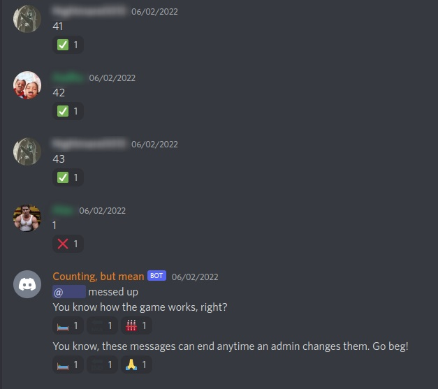

# Counting Royale
A Discord bot for counting games, with per-channel rules and configurable consequences.



## Table of Contents
* [General info](#general-info)
* [Technologies](#technologies)
* [Setup](#setup)
* [Commands](#commands)

## General Info
Set up a counting channel and choose what happens when someone breaks the sequence. Edit `config.yml` to change the bot's messages.

## Technologies
This project is created with:
* [discord.py](https://github.com/Rapptz/discord.py): 1.7.3
* [Discord Interactions](https://github.com/goverfl0w/discord-interactions): 3.0.1
* [PyYaml](https://pyyaml.org/): 5.1b1
* [Number Parser](https://github.com/scrapinghub/number-parser): 0.2.1

## Setup
Clone the repository and run these commands from its root in a Python virtual environment:

```sh
python -m pip install -r requirements.txt
python bot.py
```

Set your own bot token in local `config.yml` before starting. Do not commit this token. This is a legacy dependency stack; current Discord compatibility is not verified.


## Commands
The bot uses slash commands with a base command of ```/counting``` \
```/counting list```: \
&emsp;&emsp; Lists all of the server's counting channels or its settings
```/counting statistics```: \
&emsp;&emsp; Lists a user's strength at counting. If no arguement is given, displays your statis instead
```/counting settings view```: \
&emsp;&emsp; Views any or all of the server's settings
#### Admin-Only
```/counting toggle```: \
&emsp;&emsp; Enables counting in this channel. Requires manage server or administrator
```/counting settings adjust```: \
&emsp;&emsp; Adjusts a server's settings. Requires manage server or administrator


